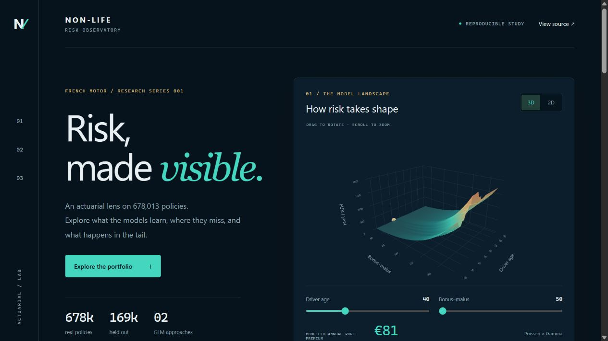
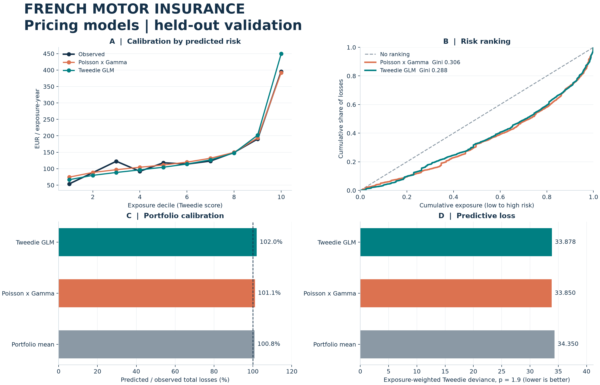

# Non-life / Risk Observatory

[**Open the interactive visual lab →**](https://zjlshuyu110.github.io/non-life-insurance-pricing/)

[](https://zjlshuyu110.github.io/non-life-insurance-pricing/)

**A reproducible non-life actuarial project in Python:** estimate annual pure premiums with frequency–severity GLMs and a Tweedie GLM, then examine calibration and risk ranking on held-out policies.

[中文说明](docs/GUIDE_ZH.md) · [Methodology](docs/METHODOLOGY.md) · [Data card](data/README.md) · [Run results](reports/report.md)

## AI text extraction → existing GLM

[**Open the Text → Pricing AI Lab →**](https://zjlshuyu110.github.io/non-life-insurance-pricing/text-to-pricing.html)

A local pretrained MiniLM question-answering model extracts driver age, vehicle age, bonus–malus and fuel from **authored synthetic applications**, retaining exact source spans. Schema checks and document/time gates precede handoff to the existing GLMs. Mileage and vehicle use are shown as research-only fields; they do not change the fitted model's price.

The recorded demonstration has 12 scenarios: 6 priced, 4 sent for review, and 2 blocked before extraction. Two **public synthetic policy PDFs** from Strata are also processed separately: the raw reader exactly matches 3 of 6 answers, with failures retained. A high-scoring wrong usage answer is preserved and rejected by the schema. The static page browses actual local runs; use the CLI for new text.

**This demonstrates integration, not improved claims prediction.** No real pre-quote text linked to subsequent claims/exposure was confirmed among the reviewed public candidates. The authored examples are development fixtures, not an independent NLP test set. Existing GLM/MLP results are unchanged. See the [dataset assessment](docs/TEXT_DATASETS.md), [measured report](reports/text_pricing/report.md), and [source manifest](data/text_demo/manifest.json).

After fitting the base GLMs:

```bash
python -m pip install -r requirements-neural.txt
python -m pip install -r requirements-text.txt
python scripts/prepare_text_demo.py --download-model
python -m nonlife.text_pricing
python scripts/build_text_showcase.py
```

For a new English application, run `python -m nonlife.text_pricing --input data/text_demo/example_input.json --output result.json`. Uses an explicitly disclosed fixed profile for five non-text fields. The pinned model download is about 133 MB; inference is local and needs no API key. Public PDFs and their extracted text retain CC BY 4.0 licensing; see [third-party notices](THIRD_PARTY_NOTICES.md).

## GLM versus an ordinary neural network

[**Open the measured GLM vs MLP comparison →**](https://zjlshuyu110.github.io/non-life-insurance-pricing/model-comparison.html)

The full-data experiment compares the original GLMs, a validation-tuned Tweedie GLM, and a plain two-layer ReLU MLP trained with exposure-weighted Tweedie loss. It uses the same 169,504 test policies; architecture and stopping epoch are selected inside the training set, then three neural seeds are refitted and reported.

| Test model | Tweedie deviance p=1.9 ↓ | Gini ↑ | Expected / observed |
|---|---:|---:|---:|
| Poisson × Gamma | 33.84999 | 0.3055 | 101.06% |
| Reference Tweedie GLM | 33.87828 | 0.2883 | 101.97% |
| Validation-tuned Tweedie GLM | 33.93753 | 0.2743 | 100.98% |
| MLP, predeclared seed 0 | 34.01770 | 0.2647 | 100.20% |

**The plain MLP did not beat the reference GLMs in this experiment.** Across three seeds, neural test deviance ranged from 33.96688 to 34.09955. Seed 0 matched total losses closely, but seed calibration varied; good total calibration does not imply good ranking. The primary paired bootstrap comparison against the validation-tuned GLM includes zero, so its small deviance difference is inconclusive under that analysis. These findings apply to this single split and limited search, not to all neural networks.

See the [bilingual experiment report](reports/model_comparison/report.md), [validation search](reports/model_comparison/validation_search.csv), [learning curves](reports/model_comparison/learning_curves.csv), [paired uncertainty intervals](reports/model_comparison/paired_bootstrap.csv) and [recorded protocol](comparison_config.json).

After reproducing the base study, run:

```bash
python -m pip install -r requirements-neural.txt
python -m nonlife.compare_neural
```

The CPU run took about 104 seconds on the original machine. Raw predictions and model checkpoints stay local; only aggregate metrics, plots and training curves are published.

## Interactive visual lab

- **3D model landscape** — rotate a WebGL surface, change driver age and bonus–malus, or switch to an accessible 2D view. Predictions use a clearly labelled illustrative fixed profile.
- **Linked cohort explorer** — filter held-out policies by driver age, region and vehicle age. Portfolio metrics, calibration and weighted deviance update together.
- **Region × age matrix** — click a cell to focus a cohort; cells with less than 30 exposure-years are hidden.
- **Tail stress lab** — compare refitted EUR 50k, EUR 200k and uncapped scenarios on the same holdout.
- **Export** — download the selected cohort's aggregated summary, or save individual plots.

The website exports **6,268 aggregate cells and 777 illustrative model profiles**, with no policy-level records. Global tail scenarios and the conditional model surface are labelled separately from cohort statistics. All assets are bundled locally; the visualization also opens offline at `docs/index.html`.

To rebuild it after rerunning the full study:

```bash
python scripts/build_showcase.py
node --test tests/test_visualization.cjs
```

Edit `visualization/` for presentation changes; `docs/` contains the generated GitHub Pages output. Node is needed only for the five aggregation/integrity tests, not to view or build the site. Python performs the modelling and data export; Plotly/WebGL renders the browser interactions.



## Business question

How much claim cost should be expected per year of exposure for a motor third-party liability policy? Does a two-model frequency–severity approach differ from a single Tweedie model, and which portfolio segments show calibration gaps?

The output is **pure premium**, not a commercial quote: expenses, commissions, taxes, profit loading and future inflation are outside scope.

## Models

| Model | Target | Training weights |
|---|---|---|
| Portfolio-mean baseline | Constant annual pure premium | Total training losses / training exposure |
| Poisson GLM | Claim count / exposure | Exposure |
| Gamma GLM | Aggregate loss / claim count, positive-loss policies only | Claim count |
| Frequency × severity | Product of the two GLM predictions | Derived from the components |
| Tweedie GLM, power 1.9 | Aggregate loss / exposure | Exposure |

This reproduces the methodology of the [scikit-learn insurance example](https://scikit-learn.org/stable/auto_examples/linear_model/plot_tweedie_regression_insurance_claims.html). It is **not a claim of bit-for-bit reproduction**: preprocessing is learned only from the training split, and the actual data provenance and dependency versions are recorded.

## Run in a new environment

Python 3.12 is recommended. Run from the project folder.

```bash
python -m venv .venv
# Windows PowerShell
.venv\Scripts\Activate.ps1
# macOS / Linux instead: source .venv/bin/activate
python -m pip install -r requirements-lock.txt
python -m nonlife.run --download-only
python -m nonlife.run --sensitivity
python -m pytest -q
```

The downloader defaults to a **commit-pinned historical snapshot in the original CASdatasets authors' repository**. OpenML timed out during this project run. To fetch OpenML instead in a fresh data directory, use `python -m nonlife.run --download-only --source openml`. Cached files are checksum-verified and reused; an existing cache is not silently replaced.

With `uv`, the installation step can be `uv pip install --python .venv/Scripts/python.exe -r requirements-lock.txt` on Windows, or use `.venv/bin/python` on Unix.

For a smaller development run:

```bash
python -m nonlife.run --sample 50000 --output reports/smoke
```

Raw data, caches, model binaries and individual predictions remain local and are ignored by Git. The committed outputs are aggregated diagnostics, figures, a notebook and reports.

## Explore the outputs

- **`reports/dashboard.html`** — open in a browser; self-contained, interactive and usable offline. Toggle model legends, hover over risk groups, and inspect cap sensitivities.
- **`reports/report.md`** — generated numerical results and cleaning audit.
- **`reports/figures/overview.png`** — portfolio-ready figure; SVG also included.
- **`reports/metrics.csv`** — training and test metrics, at matched deviance powers.
- **`reports/calibration_*.csv`** — exposure-weighted segment diagnostics.
- **`reports/sensitivity.csv`** — refits at EUR 50k, EUR 200k and uncapped losses, on identical splits.
- **`reports/run_metadata.json`** — parameters, package versions, audits and runtime.
- **`notebooks/01_pricing_walkthrough.ipynb`** — annotated walkthrough of the completed run.

## Reproduction and additions

**Reproduced:** GLM families, exposure/count weighting, benchmark fixed caps, feature types, reference regularization strengths and the 75/25 random split with seed 0.

**Added:** train-only preprocessing; constant baseline; explicit merge and cleaning audits; checksum-verified source cache; same-split loss-cap sensitivity; exposure-weighted calibration by risk, age and region; tied-score-safe Gini; offline interactive report; actuarial invariant tests.

No test-set tuning is performed. This study has a single random holdout; it does not claim future-year generalization or statistically significant superiority. Similar risks can recur under different policy IDs, so zero ID overlap alone does not prove entity independence. A production extension would investigate grouping, temporal validation, uncertainty and the uncapped tail.

## Project layout

```text
nonlife/       data loading, cleaning, models, evaluation and reporting
config.json    all modelling assumptions and benchmark parameters
data/          data card, source manifest; raw files are Git-ignored
docs/          mathematical methodology and Chinese guide
notebooks/     executed walkthrough
reports/       generated dashboard, figures and aggregate results
tests/         meaningful actuarial and data-integrity checks
```

## Attribution

- Noll, Salzmann and Wüthrich (2018), *Case Study: French Motor Third-Party Liability Claims*, [DOI: 10.2139/ssrn.3164764](https://doi.org/10.2139/ssrn.3164764).
- [scikit-learn worked example](https://scikit-learn.org/stable/auto_examples/linear_model/plot_tweedie_regression_insurance_claims.html), BSD-3-Clause; notices in `THIRD_PARTY_NOTICES.md`.
- Dutang and Charpentier, [CASdatasets](https://dutangc.github.io/CASdatasets/), and [OpenML frequency](https://www.openml.org/d/41214) / [severity](https://www.openml.org/d/41215).

Project code uses BSD-3-Clause. Source datasets retain their own terms; the project license does not relicense data. This repository is a learning and portfolio study.
