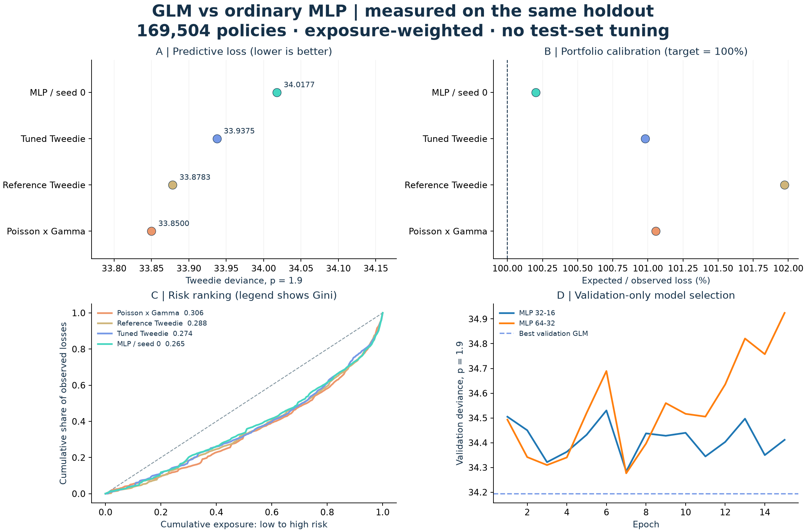

# GLM versus ordinary neural networks / 实测对比

The plain MLP does not beat the GLM benchmark. The predeclared primary MLP (seed 0) has 0.24% higher weighted Tweedie deviance than the validation-tuned GLM. The interval crosses zero; this run does not establish a deviance advantage.

**中文结论：** 主比较中，MLP（预先固定 seed 0）的测试集 deviance 比调参后的 Tweedie GLM 高 **0.24%**。这不是神经网络一定更强或更弱的普遍结论；仅针对当前数据、特征、训练预算和随机留出集。

| Model | Test deviance p=1.9 ↓ | Gini ↑ | Expected / observed | Train deviance |
|---|---:|---:|---:|---:|
| Portfolio mean | 34.350172 | 0.0000 | 100.79% | 34.385243 |
| Poisson x Gamma | 33.849988 | 0.3055 | 101.06% | 33.875848 |
| Reference Tweedie | 33.878283 | 0.2883 | 101.97% | 33.821207 |
| Tuned Tweedie | 33.937531 | 0.2743 | 100.98% | 33.913128 |
| MLP / seed 0 | 34.017704 | 0.2647 | 100.20% | 33.360512 |
| MLP / seed 1 | 34.099546 | 0.2518 | 91.61% | 33.262532 |
| MLP / seed 2 | 33.966884 | 0.2800 | 96.03% | 33.359163 |

Deviance 越低越好；Gini 衡量风险排序，越高越好；Expected / observed 越接近 100% 越好。它们回答不同的问题，不能互相替代。金额误差 MAE 和 p=1.5 deviance 也保存在 `metrics.csv`。



## Experimental protocol

- **Data:** all 678,013 policies, the same source hashes and EUR 200,000 adjusted-loss cap as the existing study.
- **Outer split:** 508,509 training / 169,504 test policies, original seed 0. Existing GLM predictions were reproduced and checked numerically.
- **Selection split:** 406,807 inner fit / 101,702 validation, seed 42, both entirely inside the original training sample.
- **Features:** identical 75 binned / one-hot / continuous features. MLP inputs additionally receive train-only scaling. No policy ID, claim amount, claim count or exposure is used as a predictor. Exposure weights the loss.
- **Reference GLMs:** original Poisson x Gamma and Tweedie settings remain unchanged. An additional Tweedie GLM selects alpha from [0.001, 0.01, 0.1, 1.0] using validation deviance; selected alpha = **1.0**. The search is small and the optimum may lie outside this grid.
- **Ordinary MLP:** two fully connected ReLU layers; positive log-link output; exposure-weighted Tweedie objective with p=1.9. No pretrained network, attention, GLM offset or ensemble. Target scaling preserves the loss optimum. Log-relative predictions are guarded to [-8, 8] for numerical stability.
- **Selection:** widths [[32, 16], [64, 32]], AdamW learning rate 0.001, weight decay 0.001, batch size 8192, gradient clipping 5.0, at most 60 epochs, patience 8. Widths and epoch are selected only on validation deviance.
- **Selected network:** **75 → 64 → 32 → 1**, 6,977 parameters, **7 epochs**. It is refitted from scratch on all outer training policies with seeds 0, 1 and 2 at the same epoch budget. Seed 0 is the primary result, not the best test seed. No post-hoc calibration is applied.
- **Runtime:** 103.8 seconds on CPU for selection, refits, evaluation and bootstrap; individual neural fitting times are in `training_runs.csv`. These timings are hardware-specific and include differing diagnostic work.

## Stability and uncertainty

Three MLP seeds produced test deviance from **33.966884 to 34.099546**, and Gini from **0.2518 to 0.2800**. These are three runs, not a confidence interval.

Paired bootstrap of 1,000 test-policy samples, with models held fixed. Difference is **MLP seed 0 minus GLM**; negative favors MLP.

| Comparator | Deviance difference | Conditional 95% percentile interval |
|---|---:|---:|
| Poisson x Gamma | 0.167716 | [0.040212, 0.310887] |
| Reference Tweedie | 0.139421 | [0.035840, 0.257776] |
| Tuned Tweedie | 0.080172 | [-0.048238, 0.228857] |

The interval crosses zero; this run does not establish a deviance advantage. These intervals assume IID policies, ignore repeated insured entities and training uncertainty, and are exploratory without multiple-comparison adjustment. The primary comparison is against the validation-tuned Tweedie GLM. They do not establish performance in a future year.

## Interpretation / 面试可以怎么讲

1. Explain the frequency–severity decomposition and why exposure is a weight rather than an ordinary input.
2. Compare GLM with a plain MLP under the **same Tweedie objective and target**, rather than fitting a generic MSE network to a mostly-zero heavy-tailed target.
3. Distinguish financial calibration, ranking and predictive loss. A model may improve one and worsen another.
4. Show the validation curves and all three seeds. Additional network capacity does not guarantee improved generalization, especially with only a small fraction of positive claims.

The test set has now been used for this comparison. Further model changes should be evaluated using a new holdout or nested / temporal validation; repeatedly using these test results to tune would contaminate the benchmark. The current experiment uses one random split, a narrow architecture / regularization search and an adjusted loss target, so it is not a broad benchmark of all neural models.

## Reproduce

```bash
python -m pip install -r requirements-lock.txt
python -m pip install -r requirements-neural.txt
python -m nonlife.run --download-only
python -m nonlife.run --sensitivity
python -m nonlife.compare_neural
python -m pytest -q
```

To regenerate only the plots and page from committed aggregate results: `python -m nonlife.compare_neural --report-only` (PyTorch environment required by the CLI). Local model binaries and policy-level predictions are Git-ignored. The generated page is `docs/model-comparison.html`.

Sources: [scikit-learn insurance example](https://scikit-learn.org/stable/auto_examples/linear_model/plot_tweedie_regression_insurance_claims.html), [Tweedie deviance definition](https://scikit-learn.org/stable/modules/generated/sklearn.metrics.mean_tweedie_deviance.html), [PyTorch reproducibility](https://docs.pytorch.org/docs/stable/notes/randomness.html). Values in this report come from this repository's actual run, not from those reference pages.
