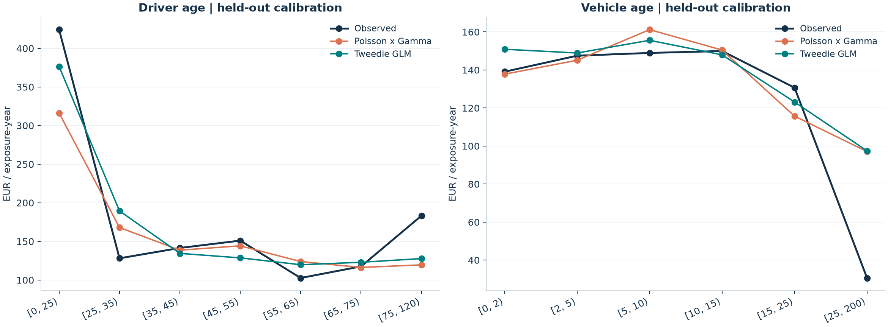

# Run report

This file is generated from the actual run; no metrics are manually entered.

Policies: 678,013. Training: 508,509. Test: 169,504.
Positive-loss test policies: 6,237.

| Model | Predicted / actual | Deviance (p=1.9) | Ranking Gini |
|---|---:|---:|---:|
| Portfolio mean | 1.0079 | 34.3502 | 0.0000 |
| Poisson x Gamma | 1.0106 | 33.8500 | 0.3055 |
| Tweedie GLM | 1.0197 | 33.8783 | 0.2883 |

Tweedie deviance reduction relative to the training-portfolio-mean baseline: 1.37%.
This is descriptive performance on a single holdout, not a significance test.




## Cleaning audit

```json
{
  "count_capped_policies": 9,
  "exposure_capped_policies": 1224,
  "amount_capped_policies": 20,
  "zero_amount_count_corrections": 9116,
  "claim_amount_cap": 200000.0,
  "claim_amount_removed": 7737579.419999994,
  "modelled_total_claim_amount": 52171637.080000006,
  "modelled_exposure_years": 358360.1054629838,
  "positive_loss_policies": 24944,
  "policy_count": 678013
}
```

## Interpretation

- Compare model deviances only under an identical target definition and Tweedie power.
- Do not interpret a high Gini as evidence of accurate total premiums; assess calibration separately.
- Caps change the target. The EUR 200k study does not price the excluded tail.
- Frequency is adjusted to positive-loss claims, following the reference; it is not all reported claims.
- Quantile bins and scaling are fit only on training policies, unlike the original example.
- The sample has no usable calendar-year holdout here; random splitting does not establish temporal generalization.

## Loss-cap sensitivity

The following are refitted models on identical policy splits. Compare models within each target definition.

| Policy loss cap | Model | Predicted / actual | Deviance (p=1.9) |
|---|---|---:|---:|
| EUR 200,000 | Portfolio mean | 1.0079 | 34.3502 |
| EUR 200,000 | Poisson x Gamma | 1.0106 | 33.8500 |
| EUR 200,000 | Tweedie GLM | 1.0197 | 33.8783 |
| EUR 50,000 | Portfolio mean | 0.9986 | 33.9444 |
| EUR 50,000 | Poisson x Gamma | 1.0012 | 33.4753 |
| EUR 50,000 | Tweedie GLM | 1.0056 | 33.4695 |
| Uncapped | Portfolio mean | 1.1919 | 34.4345 |
| Uncapped | Poisson x Gamma | 1.2030 | 33.9367 |
| Uncapped | Tweedie GLM | 1.1820 | 33.9977 |

The uncapped baseline is useful context: a train/test difference in average loss cost can affect both GLMs. A larger calibration gap does not by itself identify a modelling defect. Investigate tail concentration and repeated splits before making a production decision.

## Merge audit

Severity rows without a matching frequency policy: 195; unmatched claim amount: EUR 788,714.18. These do not enter the matched policy-level study.

Actual sources (also recorded with hashes in the manifest):

- [freMTPL2freq](https://raw.githubusercontent.com/dutangc/CASdatasets/c49cbbb37235fc49616cac8ccac32e1491cdc619/data/freMTPL2freq.rda)
- [freMTPL2sev](https://raw.githubusercontent.com/dutangc/CASdatasets/c49cbbb37235fc49616cac8ccac32e1491cdc619/data/freMTPL2sev.rda)
